# InvScan — Documentação do processo e das decisões (Trabalho 2 · MAF)

> **Grupo:** Mateus F., Ellyson V., André G.
> **Disciplina:** Desenvolvimento de Aplicativos Móveis

## 1. O que é o app

O **InvScan** é um app de inventário de patrimônio. Ele permite cadastrar itens (notebooks, computadores etc.), dizer onde cada item está guardado, marcar o que já foi conferido fisicamente e consultar tudo de forma rápida por pesquisa. Os dados ficam só na memória (como permitido pelo enunciado), então se perdem ao fechar o app.

---

## 2. Como estava o projeto no Trabalho 1 e o que mudou

**No Trabalho 1** o app tinha 3 telas estilizadas (início, exibição de patrimônio e perfil), todas dentro de **um único arquivo `MainActivity.kt` com cerca de 1.090 linhas**. Os dados eram fixos no código (o notebook "Dell i7" era sempre o mesmo) e os botões existiam só visualmente: o `onClick` era vazio. Cada tela tinha uma barra superior e uma barra inferior diferentes, com cores e tamanhos diferentes.

| | Trabalho 1 | Trabalho 2 (MAF) |
|---|---|---|
| Telas | 3, sem ligação entre elas | 11, todas navegáveis |
| Navegação | nenhuma (botões vazios) | `NavHost` central, `Rotas`, `NavigationBar` e `TopAppBar` com voltar |
| Dados | fixos no código | listas reativas (`mutableStateListOf`) que o usuário altera |
| Itens | 1 patrimônio fixo | lista de patrimônios: adicionar, remover, marcar como conferido |
| Código | 1 arquivo grande | 29 arquivos organizados por responsabilidade |
| Visual | 3 estilos de barra diferentes | tema único (claro e escuro) e componentes padronizados |

 **Prints do Trabalho 1:**

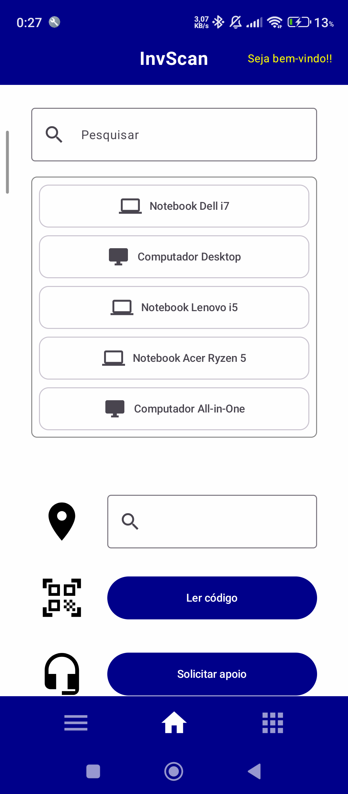
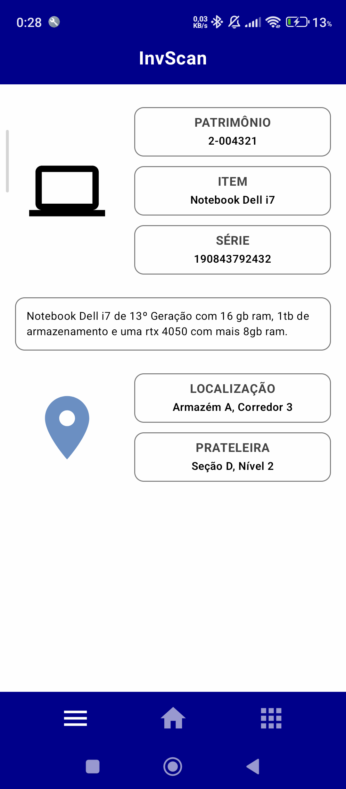
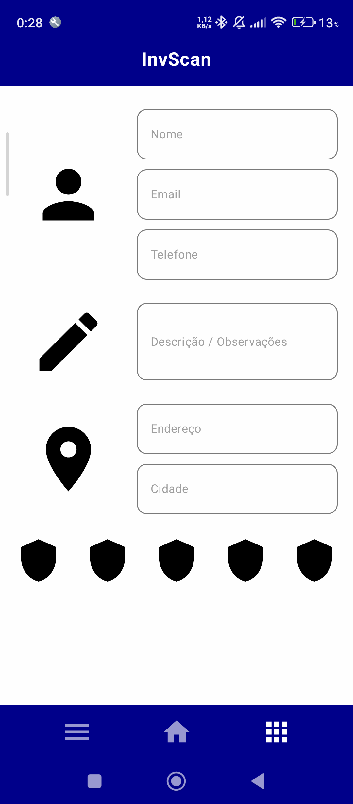

---

## 3. As telas novas: o que cada uma faz e por que escolhemos

O protótipo (wireframe) do grupo tinha 5 telas: Início, Criar Item, Usuário, Item Patrimoniado e Configurações. Para cumprir o enunciado (mínimo de 7 telas, 2 listas e 2 detalhes), mantivemos essas 5 e acrescentamos as telas que faltavam para o app funcionar de verdade.

| # | Tela | O que faz | Por que escolhemos |
|---|---|---|---|
| 1 | **Início** | Saudação, resumo (itens, conferidos, locais), pesquisa de itens e dois atalhos: *Buscar por local* e *Escanear código* | Vem do wireframe. É a porta de entrada e dá acesso rápido às duas tarefas mais comuns |
| 2 | **Menu** | Grade com todas as funcionalidades do app | Botão da esquerda da barra inferior. Dá um lugar único para chegar em qualquer tela |
| 3 | **Patrimônios** (lista 1) | Lista de todos os itens, com pesquisa, checkbox *Conferido*, lixeira e botão *Novo item* | Botão da direita da barra inferior. É a lista principal do app |
| 4 | **Detalhe do patrimônio** | Fotos em carrossel, dados do item, descrição e local. Pode ser editado ali mesmo | Vem do wireframe (*Item Patrimoniado*) |
| 5 | **Criar item** | Formulário: nome, tipo, descrição, série, local, prateleira, fotos e código | Vem do wireframe. É a forma de adicionar itens na lista 1 |
| 6 | **Locais** (lista 2) | Lista de locais, com formulário para adicionar e botão para remover | Os dois pontos do wireframe que mostram localização viraram uma segunda lista de verdade, e o botão *Buscar por local* da tela inicial levou até ela |
| 7 | **Detalhe do local** | Edita o local, mostra o progresso de conferência e lista os itens que estão nele | Segundo detalhe exigido (um por lista) |
| 8 | **Escanear código** | Busca um item pelo código da etiqueta e abre o detalhe dele | Dá função ao botão de código de barras do wireframe. Por enquanto o código é digitado (a leitura por câmera fica para depois) |
| 9 | **Usuário** | Perfil editável e 4 conquistas que dependem do uso do app | Vem do wireframe. As conquistas liberam conforme se cadastra e confere itens |
| 10 | **Configurações** | Confirmar exclusões, tema escuro, texto grande e acesso ao Suporte | Vem do wireframe. Todas as opções realmente mudam o app |
| 11 | **Suporte** | Perguntas frequentes e formulário de contato | Dá função ao botão de *headset* do wireframe |

 **Prints:**

| | | |
|---|---|---|
| 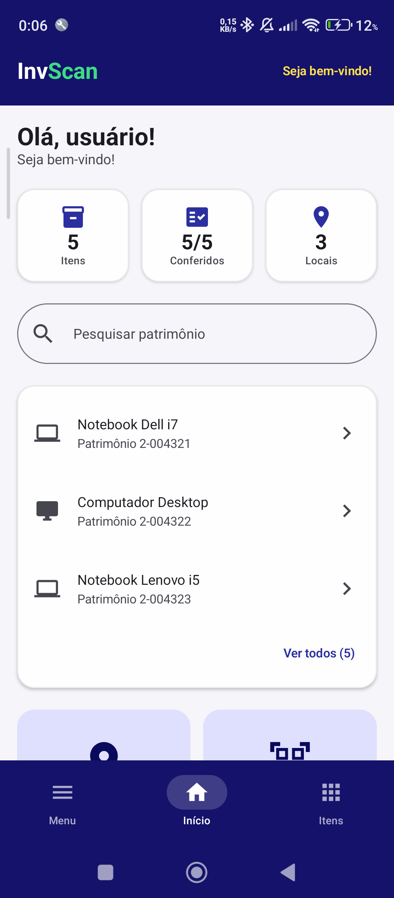 | 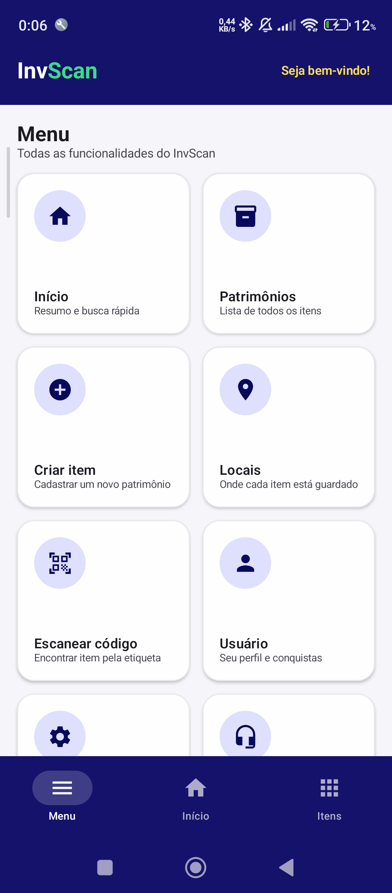 | 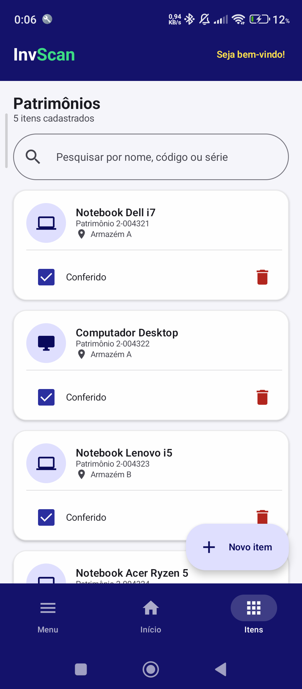 |
| 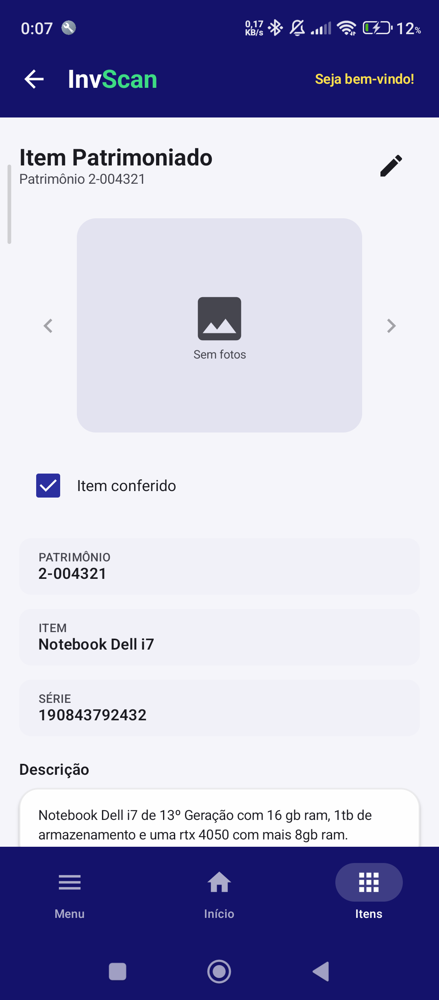 | 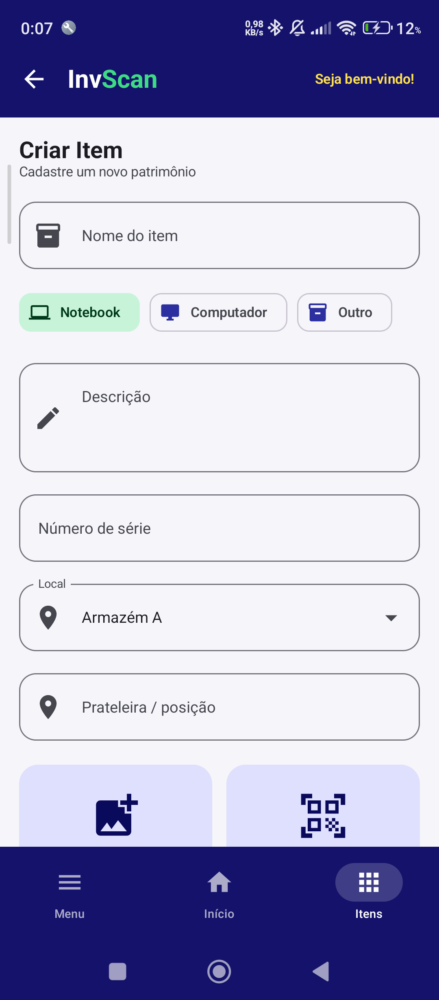 | 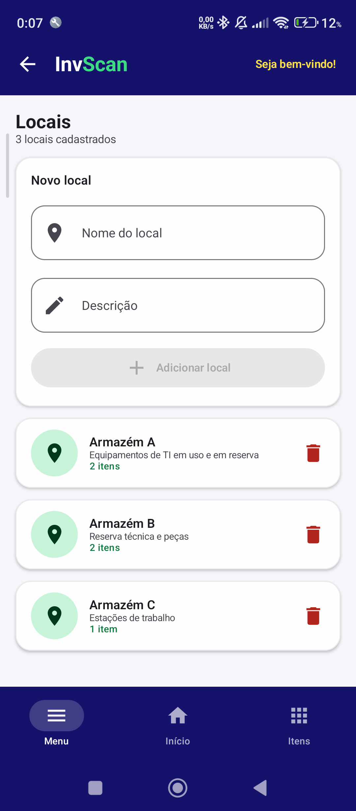 |
| 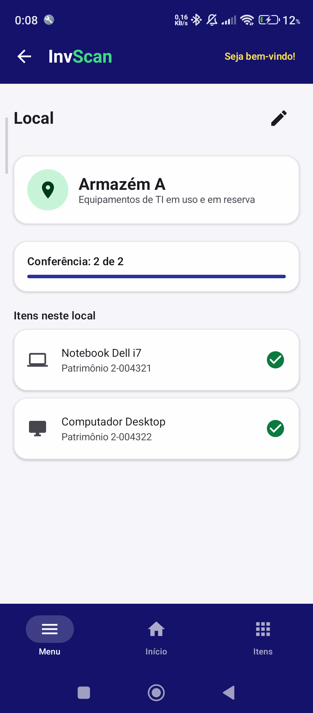 | 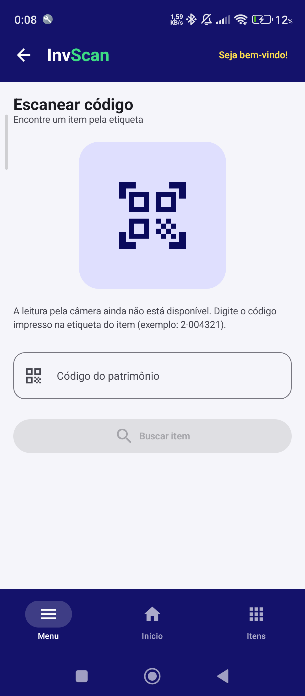 | 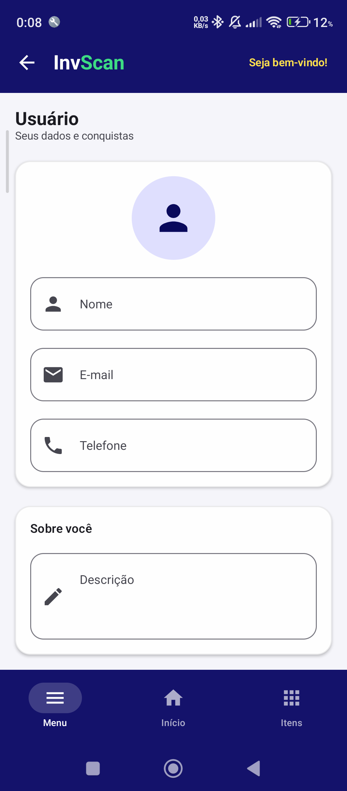 |
| 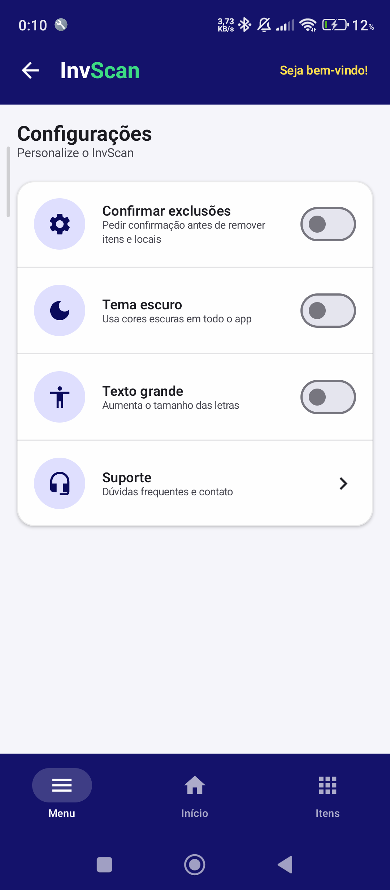 | 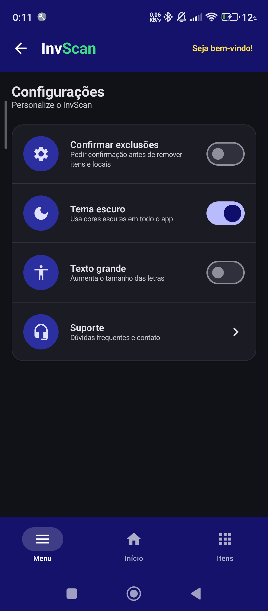 | 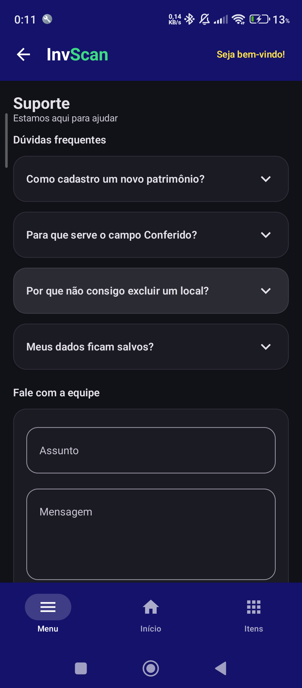 |

### Navegação

A barra inferior tem três abas: **Menu** (esquerda), **Início** (centro) e **Itens** (direita). O botão de voltar da `TopAppBar` aparece nas telas que não são raiz de uma aba e chama `navController.popBackStack()`.

Fluxos principais:
- Início → item → Detalhe do patrimônio → local → Detalhe do local → outro item
- Itens → *Novo item* → Criar item → (ao salvar) Detalhe do novo item
- Início → *Buscar por local* → Locais → Detalhe do local
- Início → *Escanear código* → (código encontrado) Detalhe do patrimônio
- Menu → qualquer funcionalidade; Configurações → Suporte

---

## 4. Decisões de configuração e organização do código

📸 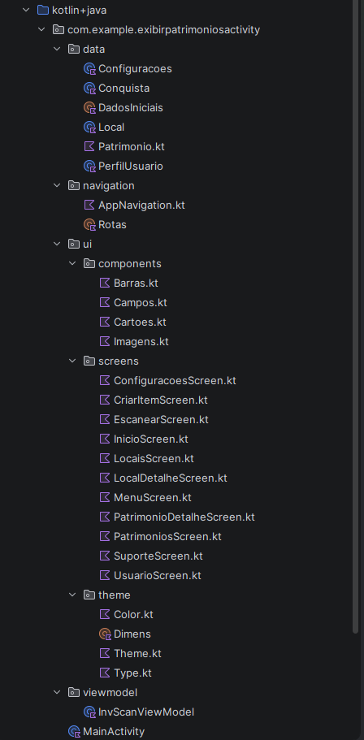

```
navigation/   Rotas.kt, AppNavigation.kt
viewmodel/    InvScanViewModel.kt
data/         Patrimonio, Local, PerfilUsuario, Configuracoes, Conquista, DadosIniciais
ui/components/  Barras, Campos, Cartoes, Imagens
ui/screens/   as 11 telas
ui/theme/     Color, Type, Theme, Dimens
```

**Rotas em um objeto com `const val`.** Todas as rotas ficam no `object Rotas`. Isso evita erro de digitação e deixa claro quais telas existem. As rotas com argumento (`patrimonio/{id}` e `local/{id}`) têm funções auxiliares (`Rotas.patrimonioDetalhe(id)`).

**Um único `NavHost` e um único `Scaffold`, em `AppNavigation.kt`.** A barra superior, a barra inferior e o `Snackbar` ficam no mesmo lugar. No Trabalho 1 cada tela repetia a sua barra. As telas não conhecem o `NavController`: recebem funções (`onAbrirPatrimonio`, `onCriarItem` etc.) e quem chama `navigate(...)` é o `AppNavigation`.

**Passamos só o `id` pela rota, não o objeto.** A tela de detalhe recebe o `id` e busca o item no ViewModel. Assim ela sempre mostra a versão atual do item, inclusive depois de editar.

**Estado em um `ViewModel` só.** O `InvScanViewModel` guarda as duas listas (`mutableStateListOf`), o perfil e as configurações. Escolhemos ViewModel (em vez de `remember` em cada tela) porque as duas listas e as configurações são usadas por várias telas e precisam sobreviver a rotação de tela.

**Relação entre as duas data classes.** `Patrimonio` guarda `localId`, e não uma cópia do local. Assim, ao renomear um local ele muda em todos os itens, e dá para calcular quantos itens cada local tem. Um local só pode ser excluído se estiver vazio, para nenhum item ficar "sem local".

**Componentes reutilizáveis.** Os cards, campos de texto, ícones circulares, carrossel de fotos e diálogos ficam em `ui/components/`. Todas as telas usam os mesmos, o que deixou o visual padronizado e reduziu o código repetido.

**Tema único com modo escuro.** Cores, formas e tipografia ficam em `ui/theme/`. As telas usam `MaterialTheme.colorScheme` em vez de cores fixas, por isso o tema escuro e o "texto grande" (nas Configurações) funcionam em todo o app.

**Barra inferior sempre volta para a raiz da aba.** Tocar numa aba leva à tela raiz dela (`popUpTo` até o Início + `launchSingleTop`), sem empilhar telas repetidas.

**Escanear código sem câmera.** Para esta etapa, o código da etiqueta é digitado. Ler pela câmera exigiria permissões e uma biblioteca de leitura, e o enunciado pede só o app funcional com dados em memória.

---

## 5. A complexidade extra na tela de Detalhes (seção 3.2 do enunciado)

No **Detalhe do patrimônio**, a tela vai além de só mostrar os dados do item:

1. **Edição no próprio detalhe.** O botão de lápis liga o modo de edição: nome, série, descrição, local, prateleira e fotos viram campos editáveis, com *Salvar* e *Cancelar*. O nome é obrigatório e a série aceita só números.
2. **Combina dados das duas listas.** Mostra o nome do local (vindo da lista de **Locais**) e quantos outros itens estão nele.
3. **Navegação secundária.** Tocar no local abre o **Detalhe do local**, que lista os itens daquele local e permite abrir cada um (e voltar).
4. **Dado calculado.** O Detalhe do local mostra uma barra de progresso de conferência (itens conferidos / total), calculada a partir da lista de itens.

**Por que essa escolha:** em um app de inventário, a pergunta mais comum é "onde está esse item e o que mais está lá?". Ligar item e local responde isso, e editar no detalhe evita ter que apagar e recriar um item para corrigir um dado.

  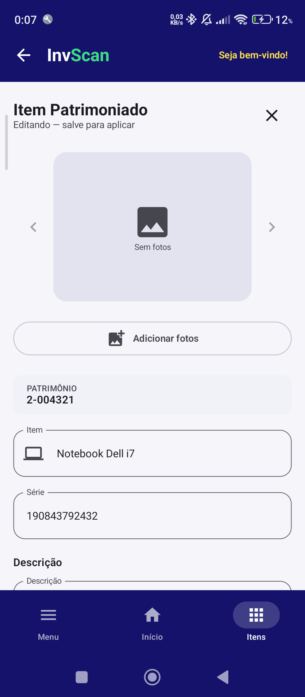

---

## 6. Dificuldades encontradas e como resolvemos

- **Código antigo misturado ao novo.** Depois de reorganizar o projeto, arquivos da versão anterior (`PatrimonioMock.kt`, `AppNavHost.kt`, `Secoes.kt`, `PatrimonioScreen.kt`, `PerfilScreen.kt`) continuaram na pasta e usavam campos que não existiam mais na data class `Patrimonio` (`item` e `localizacao`, que viraram `nome` e `localId`). *Como resolvemos:* apagamos os arquivos antigos que não eram mais usados.
- **Erro de import.** Um `import ...matchParentSize` quebrou o build, porque essa função só existe dentro do `Box` e não se importa. *Como resolvemos:* removemos a linha de import.
- **Emulador travando ao dar Run** ("device is already activating"). O Android Studio congelava porque o emulador demorava a responder ao adb. *Como resolvemos:* reiniciamos o adb (`adb kill-server` e `adb start-server`), fizemos *Cold Boot* do emulador e esperamos a tela inicial aparecer antes de rodar. Não deu certo, então desistimos de usar o emulador e passamos a usar o dispositivo físico.

---

## 7. Limitações e próximos passos

- Os dados ficam só na memória e se perdem ao fechar o app.
- Leitura de código por câmera.
- As fotos também só valem enquanto o app está aberto.
